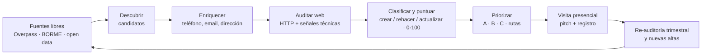
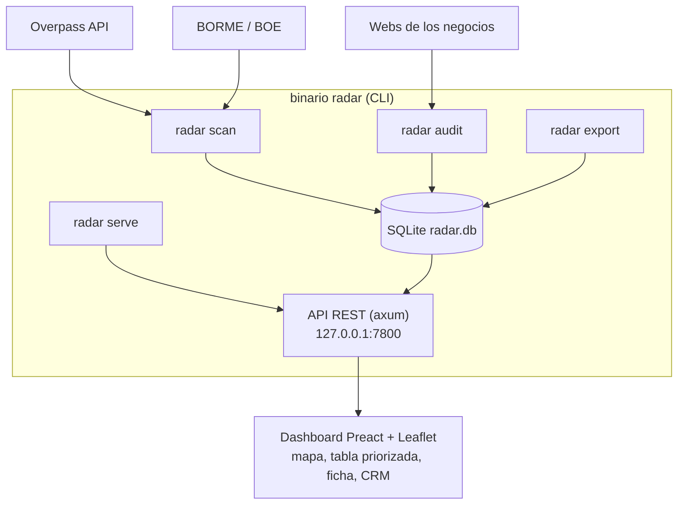

# Radar Navarra — Diseño del sistema de prospección web local

**Estado:** diseño de referencia para el producto implementado · **Fecha:** 04/11/2026
**Stack:** Rust + Preact · **Presupuesto fuentes:** 0 € (solo libres) · **Ámbito:** toda la Comunidad Foral de Navarra

---

## 1. Resumen ejecutivo

**Radar** es un programa local (un único binario Rust con dashboard web en Preact) que genera y gestiona la lista de negocios navarros a los que ofrecer servicios web. Hace cuatro cosas que Google Maps a mano no hace:

1. **Descubre** candidatos a escala Navarra y por sector, desde fuentes libres (OpenStreetMap, BORME/BOE, open data).
2. **Audita** su presencia web de forma automatizada (¿existe?, ¿funciona?, ¿es obsoleta?) y los clasifica en las tres ofertas comerciales: **crear / rehacer / actualizar**.
3. **Puntúa y prioriza** cada negocio (0–100) y lo sitúa en un mapa para planificar rutas de visita presenciales.
4. **Hace de mini-CRM**: estados del pipeline, registro de visitas y seguimiento, todo en SQLite local.

El documento cubre también el modelo de negocio, el canal Kit Digital / agentes digitalizadores, la legalidad y el roadmap. Para las mejoras priorizadas, consultar [plan-mejoras.md](plan-mejoras.md).

---

## 2. Objetivo y modelo de negocio

### 2.1 Oferta

| Servicio | A quién | Naturaleza |
|---|---|---|
| **Web nueva / landing** | Negocio sin presencia propia (solo redes o nada) | Puntual (300–1.000 € a validar en F0) |
| **Rehacer web** | Web rota, dominio aparcado, constructor abandonado (Wix/Jimdo antiguo) | Puntual + migración |
| **Actualizar / mantenimiento** | Web viva pero anticuada (sin HTTPS, no responsive, copyright 2018) | Puntual + cuota mensual (MRR) |
| **Extras** | Google Business Profile, email profesional, menú QR (hostelería), reservas | Recurrente |

La cuota de mantenimiento es la clave económica: convierte ventas puntuales en ingreso recurrente acumulable.

**Ventaja competitiva:** perfil full-stack + IoT (React/Angular, Java, Rust, MQTT/Modbus) frente al digitalizador genérico: paquetes de verdad (web + reservas + QR + analítica), no plantillas.

### 2.2 Canales de venta

1. **Venta directa presencial** (canal principal de este diseño): visitas puerta a puerta con lista priorizada.
2. **Kit Digital** (cuando reabra): argumento "web subvencionada" — ver §10.
3. **Partners digitalizadores**: agentes acreditados de Navarra con exceso de demanda o sin capacidad de desarrollo propia; Radar les aporta leads cualificados a cambio de subcontratación o comisión — ver §10.3.

### 2.3 Coherencia con la situación personal

Este proyecto convive con la búsqueda de empleo activa (procesos en curso desde enero 2027). El diseño lo asume: **time-boxing en findes de semana**, listas generadas por lotes para aprovechar visitas de sábado mañana, y sin dependencias de plazos externos. Si el flujo de trabajo se formaliza, el activo (binario + datos + cartera) es vendible o contratista-friendly.

---

## 3. Alcance

- **Geografía:** todos los municipios de Navarra; prioridad operativa Pamplona + comarca (densidad de visitas por km).
- **Sectores:** hostelería (bares, restaurantes, cafés, hoteles, albergues), comercio local (ferreterías, floristerías, moda), servicios (peluquerías, estética, talleres, artesanos), profesionales (despachos, clínicas), industria/pymes con web obsoleta, y servicios públicos/asociaciones con web mejorable. La selección fina se hace por *scoring de ticket*, no excluyendo sectores a priori.
- **Tamaño objetivo:** microempresas y autónomos (0–9 empleados) — el 95 % del tejido navarro y el segmento que peor web tiene.

---

## 4. El pipeline



Cada negocio pasa por: descubrir → enriquecer → auditar → puntuar → visitar → registrar. El ciclo se cierra con re-auditoría trimestral (una web obsoleta de hoy es un lead caliente dentro de un año) y vigilancia de altas nuevas.

---

## 5. Fuentes de datos (todas 0 €)

| Fuente | Qué da | Uso en el pipeline | Límite |
|---|---|---|---|
| **OpenStreetMap / Overpass API** | Negocios con nombre, categoría, dirección, teléfono, email, web, coordenadas, horario; filtrable por área regional y sector | Descubrir + enriquecer + mapa | El tag `website` es incompleto: "sin web en OSM" = **hipótesis a verificar en visita**, no hecho |
| **BORME (BOE, gratis)** | Constituciones diarias de sociedades en Navarra; también vía OpenMercantil (dataset/API CC BY 4.0) | **Lead caliente**: negocio nuevo = casi seguro sin web — detalle en §5.1 | Solo sociedades; autónomos no aparecen (§5.1) |
| **BON / boletines forales** | Convocatorias, licencias, anuncios institucionales | Complemento de vigilancia | Poco estructurado |
| **Open data ayuntamientos** | Licencias de actividad donde estén publicadas (Pamplona open data) | Vigilancia de aperturas | Disponibilidad desigual |
| **Catálogo Acelera pyme** | Agentes digitalizadores acreditados (filtrable por territorio) | Canal partner (§10.3) | — |
| Google Places API | Confirmación de "sin web" real + reseñas | **Descartado por presupuesto**: solo si en el futuro se acepta el tier gratuito (1.000 llamadas Enterprise/mes ≈ 20.000 registros); además sus términos solo permiten guardar el `place_id` de forma indefinida ([Biz Collect](https://bizcollect.dev/blog/google-places-api-terms), [LeadMarina](https://leadmarina.com/blog/google-places-api-pricing)) | — |
| Cámara de Comercio / Camerdata / SABI | Directorios empresariales | **Descartado**: de pago y orientado a sociedades; el target (bar, peluquería, taller) apenas figura | — |
| Scraping directo de Google Maps / Páginas Amarillas | — | **Prohibido**: viola sus términos ("No Scraping" y cláusula de no-copiar nombres/direcciones) ([Biz Collect](https://bizcollect.dev/blog/google-places-api-terms), [Better Sheets](https://bettersheets.co/blog/is-scraping-google-maps-legal)) | — |

**Regla de oro:** OSM nunca será prueba de que un negocio no tiene web; es la lista de puertas a tocar. La verificación ocurre in situ — que es exactamente el modelo de venta elegido.

### 5.1 Vigilancia de negocios nuevos (el lead más caliente)

**Sociedades — sí, gratis y por nombre (BORME).** El Registro Mercantil publica de lunes a viernes, gratis y sin registro, las constituciones de sociedades por provincia: nombre, CIF, domicilio registral, capital, objeto social y administradores ([Boletín Claro](https://boletinclaro.es/blog/que-es-borme-registro-mercantil)). Ejemplos reales recientes en Navarra: *NPR Soluciones SL* (17/08/2026), *Mimo Bienestar SL* (23/04/2026), *Gestión Turística de Navarra SL* (30/01/2026) — negocios de servicios reales, no holdings ([OpenMercantil](https://openmercantil.es/empresas/navarra)).
- **Integración actual:** API oficial de datos abiertos del BOE: consulta el sumario diario, descarga el XML de Navarra y extrae los artículos marcados como constitución. Los registros guardan el identificador y la URL del documento fuente; la ficha muestra la atribución requerida por las [condiciones de reutilización del BOE](https://www.boe.es/informacion/aviso_legal/index.php). OpenMercantil ofrece una API y datasets CC BY 4.0 como alternativa; sus datos derivados deben atribuir también a OpenMercantil.
- **Filtro necesario:** descartar por objeto social/CNAE las sociedades patrimoniales y holding sin actividad comercial visible.

**Autónomos — no existe lista pública por nombre.** Las altas del RETA (Seguridad Social) no se publican con nombres; solo hay estadísticas agregadas ([Legalcor](https://legalcor.es/como-saber-si-alguien-esta-dado-de-alta-como-autonomo/)). Detección indirecta:
- Licencias de actividad municipales (verificar en F1 qué publica el portal open data de Pamplona).
- Prensa local y notas de "nueva apertura" (Navarra.com, navarracapital.es…).
- Señal física en ruta: locales en obra, rótulos nuevos, "próxima apertura".
- Redes sociales: consulta manual puntual de aperturas recientes (sin scraping masivo).

**Canal preventivo (llegar antes de que abran):** la Cámara de Comercio de Navarra, vía España Emprende, asesoró a 283 emprendedores en un año y apoyó la creación de 64 empresas ([Cámara Navarra](https://camaranavarra.com/2024/02/16/la-camara-de-comercio-de-navarra-apoya-en-la-creacion-de-64-empresas-en-2023/)) — muchos aún con el negocio sin abrir. Un taller de "presencia digital desde el día uno" para sus emprendedores da acceso a leads que nadie más tiene.

**En el pipeline:** `radar watch --fuente borme` consulta los sumarios BOE de los últimos siete días; `--fecha YYYY-MM-DD` permite importar una publicación concreta y `--csv` conserva la importación manual. Solo se convierten artículos de constitución de Navarra en *leads de apertura* (score 90, prioridad A). Se guardan identificador y URL oficial para atribución; repetir la descarga no crea leads ni auditorías duplicadas.

---

## 6. Auditoría web — el corazón del sistema

### 6.1 Clasificación (mapea 1:1 con la oferta)

| Estado | Criterio técnico | Oferta |
|---|---|---|
| `SIN_WEB` | Sin web en fuentes (hipótesis) | **Crear** |
| `SOLO_REDES` | Su "web" es un Facebook/Instagram | **Crear** |
| `WEB_ROTA` | DNS caído, error 4xx/5xx, timeout | **Rehacer** |
| `WEB_APARCADA` | Dominio en parking / "compra este dominio" | **Rehacer** |
| `WEB_OBSOLETA` | Vive pero: sin HTTPS, sin viewport (no responsive), copyright ≥3 años viejo, constructor abandonado (Wix/Jimdo/1&1 antiguo), HTML minúsculo | **Rehacer** |
| `WEB_MEJORABLE` | Un problema menor (falta email visible, sin meta description, lenta) | **Actualizar** |
| `WEB_OK` | Sin señales negativas | Seguimiento pasivo |

### 6.2 Señales a detectar por HTTP (auditoría ligera, 1 GET por web)

- Resolución DNS / código HTTP / redirecciones (¿acaba en Facebook?)
- HTTPS nativo (no solo por redirección)
- `<meta name="viewport">` (proxy de responsive)
- `<meta name="generator">` → WordPress, Wix, Jimdo, Squarespace, Webnode, GoDaddy…
- Año de copyright (regex `©|&copy;|Derechos` + `20\d{2}`)
- Señales de parking (sedo, "domain for sale", "compra este dominio")
- Email visible en la página (regex simple)
- Tamaño y título del HTML

Una sola petición por web, con timeout de 8 s y User-Agent identificable; nada de crawling profundo.

---

## 7. Modelo de scoring

Score 0–100 = prioridad de visita. Componentes:

| Componente | Puntos |
|---|---|
| `SOLO_REDES` / `WEB_APARCADA` | +85 base |
| `WEB_ROTA` | +80 |
| `SIN_WEB` (hipótesis) | +60 base, +8 si hay teléfono (fácil contactar), +5 si hay email |
| `WEB_OBSOLETA` | +45, +15 sin HTTPS, +25 sin viewport, +15 copyright viejo, +10 constructor abandonado |
| `WEB_MEJORABLE` | +35 |
| `WEB_OK` | +10 |
| **Multiplicadores** | +10 sector de ticket alto (hostelería con terraza, taller con flota); +5 municipio denso (Pamplona); −20 posible cadena (tag `brand` o lista de franquicias) |

Prioridad: **A ≥ 70** (visitar esta semana) · **B 50–69** (este mes) · **C < 50** (seguimiento). Desempate por proximidad geográfica (cluster de barrio) para minimizar desplazamientos.

---

## 8. Arquitectura técnica — Rust + Preact

### 8.1 Visión general

Un **único binario** (`radar`) que hace el trabajo pesado y sirve en `127.0.0.1` el dashboard. Sin servidores, sin claves API, sin coste: todo local. La UI se compila con Vite y se **embebe en el binario** (rust-embed), de modo que `cargo build --release` produce una sola pieza distribuible.



### 8.2 Workspace Cargo

| Crate | Contenido | Crates clave |
|---|---|---|
| `radar-core` (lib) | Fuentes (overpass, borme, importación CSV), auditor, scoring, store, export (CSV/GeoJSON/GPX) | `reqwest` (rustls), `tokio`, `serde`, `rusqlite` (bundled), `regex`, `csv`, `anyhow` |
| `radar-cli` (bin) | Subcomandos: `scan`, `audit`, `export`, `serve`, `watch` (constituciones BORME/OpenMercantil, §5.1) | `clap` |
| `radar-ui` (Preact + Vite + TS) | Dashboard; compilado a `dist/` y embebido | `preact`, `leaflet`, `rust-embed` + `axum` en el bin |

### 8.3 Comandos previstos

```bash
radar scan  --municipio Pamplona --sector hosteleria   # Overpass → SQLite
radar scan  --municipio "Estella" --sector todos
radar audit  --prioridad A                              # auditoría HTTP concurrente
radar export --prioridad A --formato csv                # lista de visitas
radar export --formato gpx                              # ruta para el móvil
radar serve                                             # dashboard en 127.0.0.1:7800
radar api-spec > api/openapi.yaml                       # regenera el contrato OAS
```

> **Nuevo (detalle que faltaba):** las búsquedas también se ejecutan **desde la app web**:
> `POST /api/jobs/scan`, `POST /api/jobs/audit` y `POST /api/jobs/watch` lanzan el mismo
> núcleo en segundo plano y la UI consulta el progreso con `GET /api/jobs/{id}` (ADR-002).
> CLI y web comparten `radar-core`; no hay duplicación.

### 8.4 Dashboard Preact (vistas)

1. **Mapa** (Leaflet + teselas libres con atribución): pines con fondo por potencial (verde A, ámbar B, gris C), clic → ficha. Zero-cost: teselas OSM con atribución u OpenFreeMap (vector, sin key).
2. **Tabla priorizada**: filtros por sector, municipio y estado web; filas con scroll propio y encabezados/filtros visibles. Ficha con scroll independiente; oportunidades como badges informativos y Seguimiento limitado a estado y actividades.
3. **Ficha de negocio**: señales de la auditoría, historial, acciones rápidas ("planificar visita", "registrar llamada").
4. **Ruta del día**: selección manual de negocios → exportación GPX/enlace a Maps.
5. **Panel**: embudo del pipeline, distribución por estado, actividades de la semana.

**Por qué Preact (y no React):** mismo modelo de componentes con 3–4 KB de runtime, ideal para un bundle embebido en el binario; TypeScript nativo con Vite; migración de conocimiento directa desde React.

**Por qué Rust (honestamente):** un script Python resolvería la v1 más rápido. Rust aporta: auditoría masiva concurrente sin esfuerzo, binario único distribuible (portátil, sin entornos), y sobre todo un **activo reutilizable** — si el modelo funciona, la base (`radar-core` + SQLite + API) evoluciona a producto SaaS sin reescritura. Coste asumido: v1 ≈ 2–3 fines de semana siendo ya competente en Rust.

### 8.5 Modelo de datos (SQLite `radar.db`)

- **negocios**: id, nombre, categoría original, sector general, rubro normalizado, evidencias del rubro (JSON), dirección, municipio, lat/lon, teléfono, email, web, fuente, fuente_id, primera_vista, última_verificación
- **auditorias**: id, negocio_id, fecha, estado_web, score, señales (JSON)
- **pipeline**: negocio_id, estado (nuevo / contactado / visita_hecha / interesado / no_interesado / propuesta / cerrado), valor_estimado, siguiente_acción, fecha
- **eventos**: id, negocio_id, fecha, tipo (visita/llamada/email/reunión/oferta), resultado, notas

### 8.6 Qué NO es este sistema (decisiones deliberadas)

- **No es un MCP** (por ahora): el flujo es batch y local; un wrapper MCP solo tendría sentido si se usara interactivamente desde varios clientes AI. Se reevalúa en F5.
- **No scrap Google Maps ni Páginas Amarillas** (términos + fragilidad).
- **No guarda datos de APIs con restricción de almacenamiento**; OSM (ODbL) sí permite uso local con atribución.

### 8.7 Complemento: skill de Vibe

El sandbox de Vibe no tiene salida a red, así que el scraping corre en el portátil. La skill (a crear en F5) documenta el workflow para las conversaciones: subir el CSV/SQLite exportado y obtener análisis (priorización de rutas, guiones de pitch por sector, patrones en objeciones, informe semanal). Aquí Vibe sí aporta valor sin ejecutar el binario.

### 8.8 Contrato de la API (OAS) y generación determinista de código — detalle que faltaba

La API entre Rust y Preact se comunica mediante **OAS (OpenAPI 3.1)** como contrato único,
con generación determinista y automática de código de consumo en ambos lados (ADR-001):

- **Rust (servir):** las anotaciones `utoipa` en `radar-cli` definen los endpoints; el binario
  sirve la API (axum) y el contrato en `GET /openapi.json`; `radar api-spec > api/openapi.yaml`
  **genera** el contrato commiteado. `api/openapi.yaml` nunca si edita a mano.
- **Preact (consumir):** `npm run gen:api` (openapi-typescript) genera
  `radar-ui/src/api/schema.ts` desde `api/openapi.yaml`, y la UI consume la API con
  `openapi-fetch` totalmente tipado.
- **Drift check:** `scripts/ci-local.sh` falla si el contrato generado no coincide con el commiteado.

```
código Rust (utoipa) ──api-spec──▶ api/openapi.yaml ──openapi-typescript──▶ radar-ui/src/api/schema.ts ──▶ openapi-fetch
      │                                                                                                  │
      └──── sirve /api/* y /openapi.json ◀────────────────────────────────────────────────────────────────┘
```

### 8.9 Exposición en duckdns y acceso por código enviado por email — detalle que faltaba

Para que otros compañeros entren a la herramienta (ADR-005, 0 €):

- **DNS:** `radar-navarra.duckdns.org` (duckdns) apuntando a la IP pública del equipo;
  `scripts/duckdns-update.sh` (cron cada 5 min, token en `RADAR_DUCKDNS_TOKEN`) mantiene la IP.
- **TLS y proxy:** Caddy con certificado Let's Encrypt automático (`deploy/Caddyfile`,
  port-forward 80/443 en el router) hace `reverse_proxy 127.0.0.1:7800`. El binario solo
  escucha en `127.0.0.1`.
- **Login:** email + **código OTP de 6 dígitos enviado por email** (`POST /api/auth/request-code`
  → `POST /api/auth/verify`). Allowlist: `hello@carlotacarrillo.eu`, `sergio.erramuzpe@gmail.com`,
  `pezonetis@gmail.com`, `duarmeler@gmail.com` (ampliable con `RADAR_AUTH_EMAILS`).
  Códigos hasheados (SHA-256) en SQLite, caducan en 10 min, máx 5/hora por email y 5 intentos;
  sesión JWT de 7 días en cookie HttpOnly Secure revocable. SMTP configurable con
  `RADAR_SMTP_*` (sin configurar, modo dev: el código sale en el log). Detalles en
  `docs/exposicion-duckdns.md`.

### 8.10 UI: Preact + Signals + TS — detalle que faltaba

El dashboard usa **Preact + @preact/signals + TypeScript estricto** (ADR-003): stores con
`signal`/`computed` (`stores/auth.ts`, `stores/negocios.ts`, `stores/jobs.ts`), cliente
`openapi-fetch` con tipos generados desde el OAS, Vite para compilar y Leaflet con teselas
libres para el mapa. Bundle pequeño (~58 KB gzip), embebible en el binario.

---

## 9. Flujo operativo semanal (cuando esté en marcha)

- **Mensual:** `radar scan` por sector/municipio + `radar audit`. Listas frescas, re-auditoría de lo anterior.
- **Viernes (30 min):** en el dashboard, seleccionar la ruta del sábado (cluster de barrio, prioridad A).
- **Sábado mañana (3 h):** 10–15 visitas con tríptico + QR a demos del portfolio propio.
- **Sábado tarde (20 min):** registrar eventos en el dashboard; los "no interesados" quedan en seguimiento pasivo.
- **Trimestral:** re-auditoría; un "no" del pasado puede ser un "sí" con la web aún peor de vieja.

---

## 10. Kit Digital y canal partners

### 10.1 Estado del programa (nov. 2026)

Las convocatorias están **cerradas** (la última cerró el 31/10/2025), pero la Orden TDF/39/2026 mantiene el programa vigente **hasta agotar fondos** y obliga a Red.es a redistribuir los remanentes, incluso reactivando solicitudes en lista de espera; la reapertura se espera sin fecha oficial ([Factorydea](https://factorydea.es/actualizacion-kit-digital/), [BierzoSEO](https://bierzoseo.com/agente-digitalizador/), [Acelera Pyme AECIM](https://acelerapyme-aecim.com/ayuda-digitalizacion/kit-digital-2026-ayudas-para-la-digitalizacion-de-pymes-y-autonomos-orden-tdf-39-2026-modificacion-de-bases-reguladoras/)).

Bonos por plantilla media (según última convocatoria vigente): **2.000–3.000 €** (0–2 empleados, segmento III), **6.000 €** (3–9), **12.000 €** (10–49), **25.000 €** (50–99), **29.000 €** (100–249) ([Factorydea](https://factorydea.es/actualizacion-kit-digital/), [FusionStartups](https://fusionstartups.com/blog/kit-digital-autonomos)). La solución "sitio web y presencia en internet" va dentro del catálogo. El bono se cede al agente digitalizador y el negocio solo paga el IVA (y el exceso sobre bono) ([BierzoSEO](https://bierzoseo.com/agente-digitalizador/)).

### 10.2 Cómo encaja en el plan

- **Argumento de venta:** cuando reabra, "tu web te sale subvencionada" es el pitch más corto posible para el segmento III (autónomos). El pipeline de Radar queda preparado para marcar negocios elegibles.
- **No es el plan A:** depende de una reapertura sin fecha. La venta directa funciona con o sin Kit.
- **Futuro:** si se regulariza la actividad, valorar la **acreditación propia** — hoy inviable: exige facturación mínima (≈70.000 € en 2 años para autónomos/microempresas, 100.000 € para empresas) y una web dedicada al programa ([Millennials Consulting](https://millennialsconsulting.es/como-ser-agente-digitalizador-autorizado/), [Fandit](https://blog.fandit.es/agente-digitalizador-kit-digital-con-fandit/)). Vigilar también el **Bono de IA** (piloto previsto 2027) ([Fandit](https://blog.fandit.es/agente-digitalizador-kit-digital-con-fandit/)).

### 10.3 Canal partner con agentes digitalizadores (lo que pediste)

Los agentes acreditados (catálogo filtrable en acelerapyme.gob.es) son empresas con demanda de webs de bono y, a menudo, **capacidad de desarrollo justa**. Propuesta de acercamiento:

1. Extraer del catálogo los agentes con actividad en Navarra (fuente 0 €, ya en el pipeline).
2. Oferta: **Radar les aporta leads navarros cualificados** (sin web, elegibles por segmento) a cambio de subcontratación del desarrollo o comisión por cierre.
3. Gancho para el primer contacto: mostrar 10 ejemplos reales de negocios pamploneses con web rota/obsoleta — evidencia de que se trae trabajo, no se pide.
4. Documentar en `pipeline` como canal separado (campo `canal: partner_X`).
5. **Cámara de Comercio de Navarra / España Emprende** (§5.1): ofrecer un taller de presencia digital a sus emprendedores — acceso a negocios antes incluso de que abran.

---

## 11. Legal y privacidad

- **OpenStreetMap:** datos bajo ODbL — uso y almacenamiento local libre con atribución (© OpenStreetMap contributors); las teselas de mapa exigen respetar su política de uso (alternativa: OpenFreeMap).
- **Google:** scraping prohibido por sus términos; si algún día se usa su API, casi nada de lo que devuelve es almacenable (solo `place_id` indefinido; coordenadas 30 días) ([Biz Collect](https://bizcollect.dev/blog/google-places-api-terms), [Better Sheets](https://bettersheets.co/blog/is-scraping-google-maps-legal), [Open Places API](https://openplacesapi.com/blog/can-you-store-places-api-results)).
- **BORME/BOE:** documentos públicos; la reutilización está permitida en sus condiciones.
- **RGPD / LSSI:** datos de contacto de negocios publicados por los propios interesados; la prospección B2B a profesionales está amparada por el art. 21 LSSI cuando se relaciona con su profesión. Visita presencial = la vía más limpia; evitar email masivo indiscriminado y respetar oposiciones registradas. La auditoría toca solo la web pública del negocio (1 GET), no crawls.
- **Prudencia general:** esto es orientación, no asesoramiento jurídico.

---

## 12. Roadmap

| Fase | Contenido | Criterio go/no-go |
|---|---|---|
| **F0 — Validación manual** (semana 1, 0 €) | 20–30 visitas con lista hecha a mano en Google Maps; probar pitch, tríptico y precios | ≥10 % de visitas → reunión/oferta. Si no, iterar pitch antes de construir nada |
| **F1 — núcleo Rust** (2–3 findes de semana) | `radar-core` + CLI: `scan`, `audit`, `export` CSV. Primer lote real de datos | El lote priorizado ahorra ≥2 h/semana vs. manual |
| **F2 — dashboard base** (1 fin de semana) | Preact: tabla priorizada, ficha, pipeline, eventos | Se usa de verdad en la ruta semanal |
| **F3 — mapa y rutas** (1 fin de semana) | Leaflet + exportación GPX + panel KPIs; `watch` BORME | Rutas por barrio reducen km/visita |
| **F4 — Kit Digital reapertura** (cuando ocurra) | Marcar elegibles por segmento; contacto con agentes de Navarra (§10.3) | ≥2 partners o bonos en tramitación |
| **F5 — opcional** | Skill de Vibe para análisis; wrapper MCP solo si hay uso interactivo real multi-cliente | Decidir con datos de uso |

---

## 13. KPIs

- Visitas/semana (objetivo inicial 10–15) y conversión visita→reunión→propuesta→cierre
- Ticket medio por proyecto y **MRR de mantenimiento acumulado**
- Coste por lead visitado (tiempo + desplazamiento)
- Cobertura: % de municipios navarros escaneados y % de prioridad A visitadas

---

## 14. Riesgos y mitigaciones

| Riesgo | Mitigación |
|---|---|
| Cobertura OSM incompleta (falsos "sin web") | Tratar como hipótesis; verificar in situ; añadir fuentes (BORME, open data) progresivamente |
| Puerta fría con conversión baja | F0 obligatoria antes de construir; tríptico + QR a demos; guion por sector |
| Kit Digital no reabre a corto plazo | El plan no depende de él (venta directa es el canal A) |
| Tiempo (coincide con búsqueda de empleo y pruebas en enero 2027) | Time-boxing en findes de semana; lotes; sin deadlines externos |
| Sobre-ingeniería del stack | F1 entrega CSV útil sin UI; el dashboard solo existe si se usa en F0/F2 |

---

## 15. Decisiones abiertas

1. **Nombre** del proyecto/herramienta (propuesta de trabajo: "Radar").
2. **Web propia/portfolio**: imprescindible como demo de venta (landing con portfolio y precios) — cuándo.
3. **Tríptico físico** vs. QR solo; contenido del pitch por sector.
4. **Paquetes y precios** definitivos (validar en F0).
5. Prioridad geográfica inicial (¿Pamplona centro antes que comarca?).
6. ¿CRM dentro del binario (propuesto) o hoja aparte?

---

## 16. Organización del repositorio y sistema de tareas

El repo se organiza para que trabajen varias personas/agentes a la vez (ADR-004):

```
api/openapi.yaml        Contrato OAS (generado desde Rust; no editar a mano)
crates/radar-core/      Fuentes, auditor, scoring, store SQLite, export
crates/radar-cli/       Binario: CLI + API (axum+utoipa) + auth OTP + sirve la UI
radar-ui/               Preact + Signals + TS + cliente generado desde el OAS
deploy/Caddyfile        Proxy TLS para duckdns
scripts/tasks.sh        Sistema de tareas: list/ready/claim/done/validate/board
scripts/duckdns-update.sh, scripts/ci-local.sh
tasks/T-*.md + board.md Una tarea por archivo (frontmatter: estado, asignado, depends...)
docs/                   Este diseño, los ADR (docs/adr/) y las guías (api, duckdns)
```

**Sistema de tareas:** `scripts/tasks.sh list --estado ready` → `claim T-XXX <persona|agent:x>`
→ trabajar → `done T-XXX` → `validate && board`. Estados `backlog → ready → in_progress → done`
(con `blocked`), dependencias que impiden empezar antes de tiempo y detección de ciclos.
La asignación es única por tarea (persona o agente). Reglas completas en `tasks/README.md`.

## 17. Fuentes principales

- Google Places: precios y límites de almacenamiento — [LeadMarina](https://leadmarina.com/blog/google-places-api-pricing), [AnyGen](https://www.anygen.io/showcase/google-places-api-cost/index.html), [Livescraper](https://livescraper.com/blog/google-places-api-limits), [Biz Collect](https://bizcollect.dev/blog/google-places-api-terms), [Better Sheets](https://bettersheets.co/blog/is-scraping-google-maps-legal), [Open Places API](https://openplacesapi.com/blog/can-you-store-places-api-results)
- Kit Digital y agentes digitalizadores — [Factorydea](https://factorydea.es/actualizacion-kit-digital/), [BierzoSEO](https://bierzoseo.com/agente-digitalizador/), [Acelera Pyme AECIM](https://acelerapyme-aecim.com/ayuda-digitalizacion/kit-digital-2026-ayudas-para-la-digitalizacion-de-pymes-y-autonomos-orden-tdf-39-2026-modificacion-de-bases-reguladoras/), [FusionStartups](https://fusionstartups.com/blog/kit-digital-autonomos), [Millennials Consulting](https://millennialsconsulting.es/como-ser-agente-digitalizador-autorizado/), [Fandit](https://blog.fandit.es/agente-digitalizador-kit-digital-con-fandit/), [Red.es](https://www.red.es/es/area-prensa/notas-prensa/los-agentes-digitalizadores-ya-pueden-adherirse-al-programa-kit-digital)
- Negocios nuevos en Navarra — [Boletín Claro](https://boletinclaro.es/blog/que-es-borme-registro-mercantil), [OpenMercantil](https://openmercantil.es/empresas/navarra), [Cámara de Comercio de Navarra](https://camaranavarra.com/2024/02/16/la-camara-de-comercio-de-navarra-apoya-en-la-creacion-de-64-empresas-en-2023/), [Legalcor](https://legalcor.es/como-saber-si-alguien-esta-dado-de-alta-como-autonomo/)
- OpenStreetMap: Overpass API y licencia ODbL — documentación oficial del proyecto


## Actualización: calidad y reconstrucción

La admisión por evidencias, la reconstrucción y los cambios de pantalla se describen en [calidad-y-reconstruccion.md](calidad-y-reconstruccion.md). Los servicios en la ficha son informativos; sus antiguos controles y métricas de resolución ya no forman parte de la interfaz. El proceso usa identidades y dimensiones documentadas de las organizaciones, sin reglas que enumeren marcas.

## Auditoría técnica y descubrimiento de webs (noviembre 2026)

La extensión contractual se documenta en [Webs y auditoría técnica](webs-y-auditoria-tecnica.md). Las candidatas se separan de las URLs confirmadas; el worker no tiene acceso a SQLite y devuelve cuatro fases independientes por sitio. La API expone estado, historial y descarga autenticada. OpenAPI y el cliente TypeScript son generados desde el backend.
